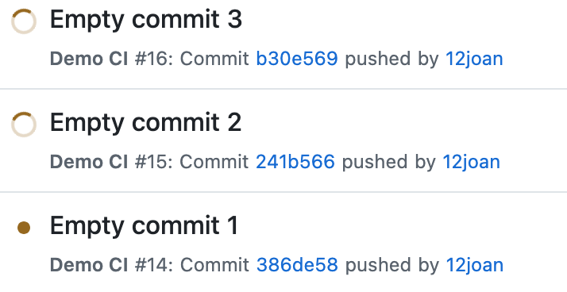
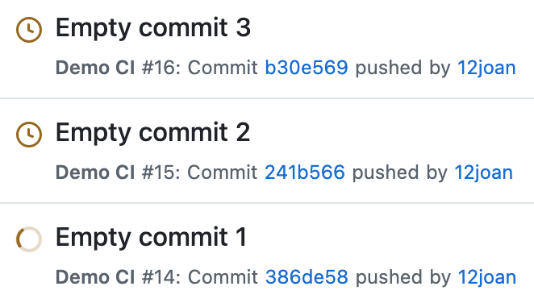
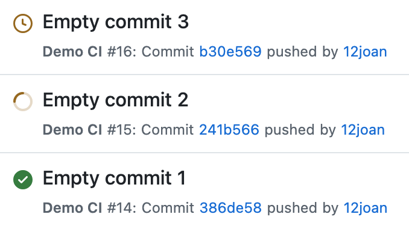
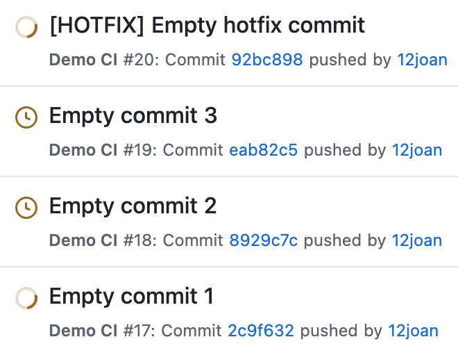
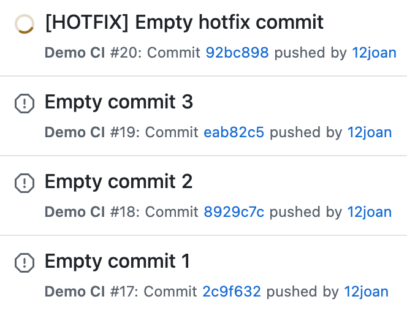
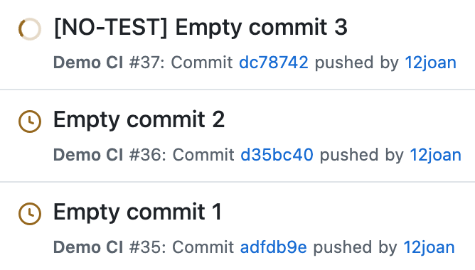
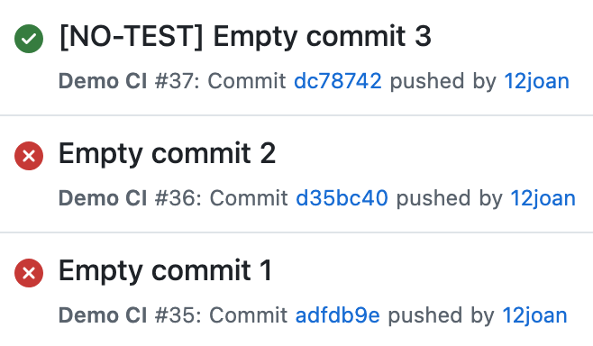

# GitHub workflow hotfix demo

This repo demonstrates how GitHub workflows can be configured such that, by default, a particular workflow job runs in a queue, but commits tagged `[hotfix]` can skip this queue and cause all previous pending or in-progress jobs to be cancelled.

## How it works

### Concurrency group

https://github.com/12joan/hotfix-gh-workflow-demo/blob/3c83b5ae57ac97097f629486c3459fe816293c9e/.github/workflows/ci.yml#L17-L20

The concurrency group tells GitHub to queue up the `deploy` job so that we don't try to deploy multiple versions at once. The `test` job has no concurrency group, which means that the tests run immediately for each push, without waiting for the previous run to finish. This happens for both regular commits and `[hotfix]` commits.

Here's what each property means:

- `group` - This option uniquely identifies the group. Since this particular job runs only on the main branch, I've used a hardcoded string here, but you'll often see `group: ${{ github.workflow }}-${{ github.ref }}` for jobs that should run independently on multiple branches.
- `queue` - This controls what happens when there are multiple pending jobs. By default, GitHub only allows one running and one pending job; if a new pending job is added, then the existing pending job is cancelled.
  - For most commits, we're setting `queue` to `max`, which means that up to 100 jobs can be pending at once. Typically, this means that the job will run once for every pushed group of commits, one at a time, without skipping any, and in the order in which they became pending. If you want to ensure that the job runs for each commit individually, make sure you push them one at a time.
  - If the commit message contains the string `[hotfix]` (case insensitive), we instead set the `queue` to its default value of `single`. This allows us to set `cancel-in-progress` to true, since GitHub doesn't allow both `cancel-in-progress` and `queue: max` to be enabled at once.
- `cancel-in-progress` - If this option is true, GitHub will cancel any already running job when a new job becomes pending. We set this to true for `[hotfix]` commits only, meaning that these commits will jump the queue and cancel anything that's already in progress.

### Enforcing chronological order

GitHub will run pending jobs in the order in which they became pending, but there's no guarantee that this order will be chronological. If the `test` job for a later commit finishes earlier than the `test` job of an earlier commit, the later commit's `deploy` job will enter the queue of pending jobs first, causing the jobs to run in the wrong order.

Users have [requested](https://github.com/orgs/community/discussions/185892) the ability to control the ordering of GitHub workflows explicitly as part of concurrency groups, but currently no option for this exists.

For workflows where we only care about the most recent commit being deployed, the [standard solution](https://github.com/orgs/community/discussions/185892#discussioncomment-15640277) is to check that the commit we're deploying is the latest on the branch. However, since this demo requires all commits to be deployed individually, we need a slightly different safeguard against incorrectly ordered deployments.

https://github.com/12joan/hotfix-gh-workflow-demo/blob/3c83b5ae57ac97097f629486c3459fe816293c9e/.github/workflows/ci.yml#L21-L48

We do this by adding a new step to the `deploy` job. This step uses GitHub's CLI to fetch the run number of the most recently completed workflow run and compares it to the current run's number. If the last completed run number is greater than ours, we fail the job.

Fetching the most recently completed workflow run requires the `actions: read` permission, which is added to the `deploy` job.

If you prefer to cancel the skipped `deploy` jobs rather than failing them, this can be done using GitHub's API: https://stackoverflow.com/a/78313363

## Try it out

To try it yourself, fork this repo and try pushing commits one at a time. You can use `git commit --allow-empty` to create a commit without changing any files. Go to the Actions tab to see the currently running workflows for each commit.

Remember to set the upstream to your fork before running any of the following commands; otherwise they may not work correctly.

### Push empty commits

Run this command to push three empty commits with a five-second delay between each one.

```bash
for i in 1 2 3; do
  git commit --allow-empty -m "Empty commit $i" && git push && sleep 5
done
```

|  |  |  |
| ------------------------------------------------------------ | ------------------------------------------------------------ | ------------------------------------------------------------ |
| Initially, the `test` job runs for all commits, so they all show as in progress. | When the `test` job finishes, the second and third commits become pending. | When the first commit finishes, the second commit begins its `deploy` job. |

### Push a hotfix commit

Run this command to push three empty commits, followed by a hotfix commit.

```bash
for i in 1 2 3; do
  git commit --allow-empty -m "Empty commit $i" && git push && sleep 5
done
git commit --allow-empty -m "[HOTFIX] Empty hotfix commit" && git push
```

|  |  |
| ------------------------------------------------------------ | ------------------------------------------------------------ |
| Initially, the empty commits are queued up as before, while the hotfix commit's `test` job runs. | When the hotfix commit's `deploy` job is ready, it cancels all other commits' jobs. |

### Enqueue deploy jobs in the wrong order

Run this command to push two empty commits, followed by a third empty commit that skips the `test` job, causing the `deploy` job to become ready sooner.

```bash
git commit --allow-empty -m "Empty commit 1" && git push
git commit --allow-empty -m "Empty commit 2" && git push
git commit --allow-empty -m "[NO-TEST] Empty commit 3" && git push
```

|  |  |
| ------------------------------------------------------------ | ------------------------------------------------------------ |
| The no-test commit's `deploy` job becomes ready soonest (since tests are skipped), so runs first. | The first two commits' `deploy` jobs see that run #37 has finished first, so they fail. |

The output from the two failed `deploy` jobs is:

```
The last completed workflow run was #37
Cancelling since workflow run #37 finished first
Error: Process completed with exit code 1.
```
